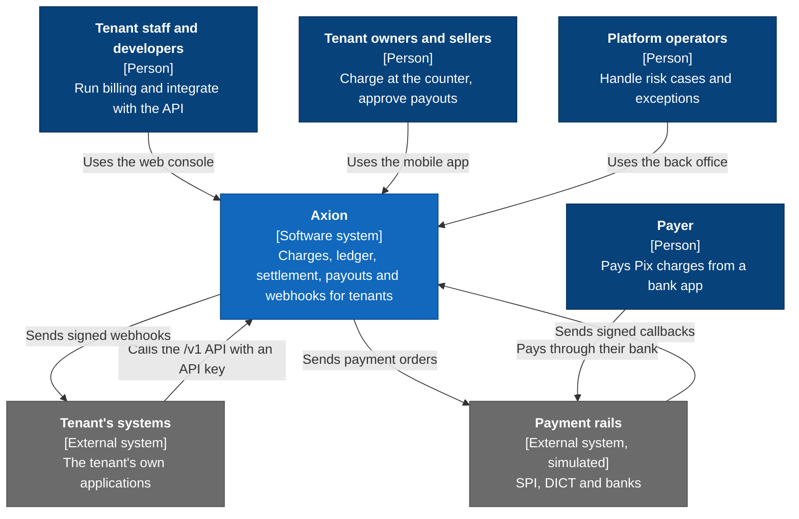

# C4 system context

The [C4 model](https://c4model.com) system context: Axion as one box, the people who use it and the systems it talks to. The containers inside the box are described in section 3 of the [platform overview](../design-docs/2026-11-17-platform-overview.md#3-architecture).

| Element | Role |
|---|---|
| Tenant staff and developers | Use the web console: dashboard, charges, ledger, API keys, webhook endpoints |
| Tenant owners and sellers | Use the mobile app: "Charge now" at the counter, biometric payout approval (phases 1b and 2) |
| Platform operators | Use the back office in the same web app: risk cases, dead letters, kill switches |
| Payer | Pays a Pix charge; never talks to Axion directly, only through the rails |
| Tenant's systems | Create and read charges through the public `/v1` API and receive webhooks |
| Payment rails | The Central Bank's Pix infrastructure (SPI, DICT) and other banks. Axion connects to none of them: `services/rails-simulator` plays their part over a real network boundary, so timeouts, duplicates and outages are real |

The identity provider (Keycloak) and the database are inside the Axion boundary: they are containers of the system, not systems it integrates with.

The diagram is Mermaid text, rendered by GitHub, so it changes in pull requests like code. It changes when a person or an external system is added or removed.
